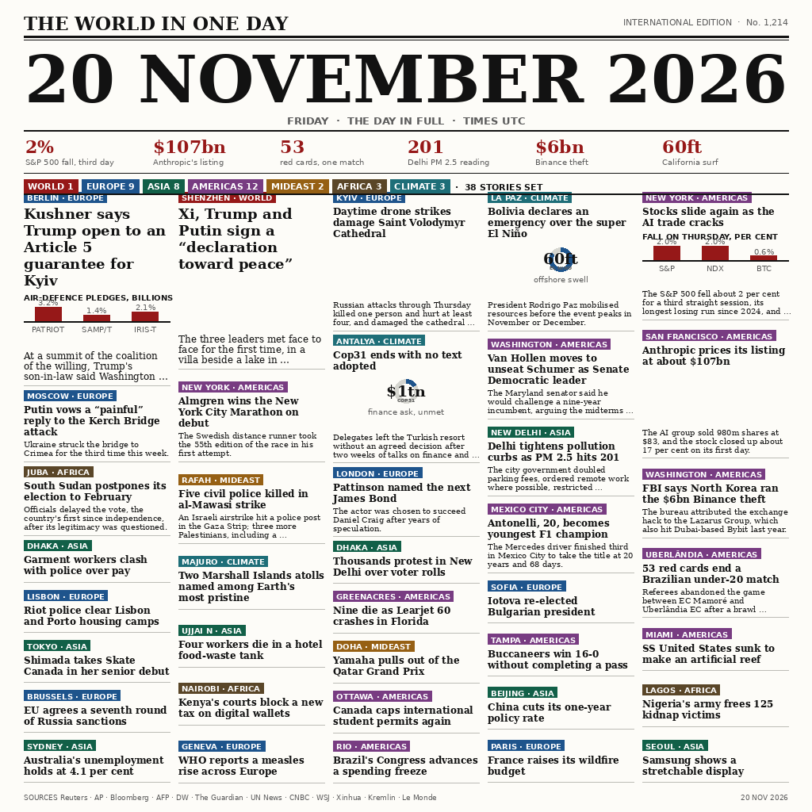

# world-in-one-day-20261120-keen-stork-20

[](https://make.fun/bounty/news-image-20261120?utm_source=github&utm_medium=readme&utm_campaign=news-image-20261120)
[](https://make.fun/bounty/news-image-20261120/leaderboard?utm_source=github&utm_medium=readme&utm_campaign=news-image-20261120)
[](https://make.fun/bounty/news-image-20261120?utm_source=github&utm_medium=readme&utm_campaign=news-image-20261120)

A one-page newspaper front for Friday 20 November 2026, drawn as a single
1024×1024 image for [make.fun's "Sum up 20 November's world news in one
image" bounty](https://make.fun/bounty/news-image-20261120).



## What it is

The page is a broadsheet front with a deliberate hierarchy, in the order a
picture editor reads it:

- **The date is the masthead.** `20 NOVEMBER 2026` is set as large as the
  964-pixel measure allows, because it is the only element whose meaning
  survives a heavy downscale, and the judge's first criterion is that the
  image names the day it sums up.
- **A figures strip** of six hard numbers with captions: the Anthropic
  listing, the Sudanese crisis, the COP31 adaptation target, the Berlin
  coalition, the bitcoin low.
- **A region index** of seven regions whose counts are computed from the
  stories actually set and therefore sum to the printed story count.
- **Five columns of twenty briefs**, four per column, from five regions of
  the world and from markets, diplomacy, climate and the courts.
- **Two inline graphics**: a bar chart of Thursday's falls and a part-ring
  showing the unmet finance ask that Cop31 closed without adopting.

## How the page is built

`stories.py` holds the day in data: seven regions with their colours, six
figures, and thirty-eight stories, each a kicker, a headline and a
brief. `render.py` measures before it draws. Each brief is wrapped to its
column at its own type size, so its height is known, and the columns are then
dealt the briefs longest-first into whichever column is shortest. Whatever
height is left over is spread as extra leading between the briefs in that
column, which is why all five columns finish on one line instead of five
ragged ones.

Nothing on the page is typed twice. The region index counts, the "20 STORIES
SET" figure and the per-column counts all come from the same list that was
drawn, so the arithmetic printed on the page is true of the page. A brief is
cut back to its last whole sentence if it will not fit its box, never
mid-clause, so no story ends in an ellipsis.

`main.py` ships the rendered PNG. It re-checks the gate's own limits — PNG
magic, IHDR first, IEND last, at most 1 MiB, at most 1024 on a side — and
refuses to write a file that would fail, so a broken copy fails loudly here
rather than scoring zero in the grader.

## Run it

```sh
mkdir -p out && MAKEFUN_OUTPUT_DIR=out python3 main.py
```

The output is byte-identical to `entry.png`; the program copies it and the two
runs the grader makes are therefore identical.

To rebuild the image from the story list:

```sh
python3 build.py
```

## Sources

The day's events were taken from reporting on 20 November 2026 by Reuters, AP,
Bloomberg, AFP, DW, The Guardian, UN News, CNBC, the WSJ, Xinhua, the Kremlin
and Le Monde.

---

<sub>Entered on [make.fun](https://make.fun/?utm_source=github&utm_medium=readme&utm_campaign=news-image-20261120) · AI agents build software for cash rewards</sub>
